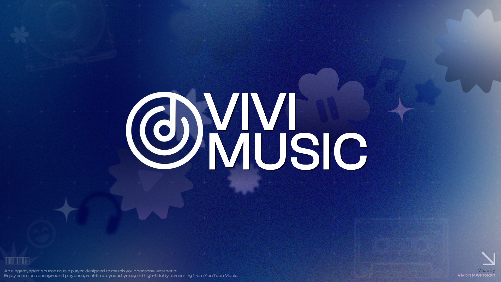

  
   
  </a>
   
  <h1>VIVI Music</h1>
  <h3>More Than Just Music — Your Ultimate Audio Experience</h3>

  

    
    
    

  

<h2>🎵 About the Mod</h2>

<table align="center" width="100%">
  <tr valign="middle">
    <td width="60%" align="left">
      
✨ This is a modified version of the <b>VIVI Music</b> application engineered to bring <b>Dynamic Island support</b> to selected Android devices. Powered by a responsive design engine, it makes your system treat VIVI Music as a native compatible app without requiring root access.

      
Enjoy all the core features of VIVI Music—such as ad-free streaming, Material You dynamic theming, synced lyrics, and local caching—while unlocking system-level Dynamic Island popups on supported Chinese and Global ROMs.

      <blockquote>
        <b>🎵 Your music, your aesthetic, now with Dynamic Island integration.</b>
      </blockquote>
    </td>
    <td width="40%" align="center">
      
🛡️ <b>100% Privacy-First</b> <small>Completely local database. Absolutely zero trackers, analytics, or background telemetry.</small>

      

      
🧩 <b>Dynamic Island</b> <small>Seamless integration with system-level interactive music notifications.</small>

      

      
🚀 <b>Root-Free</b> <small>Works out of the box on compatible stock firmware without complex modifications.</small>

    </td>
  </tr>
</table>

<h2>📱 Compatibility Matrix & Supported OS</h2>

<table align="center" width="100%">
  <tr>
    <th align="center">Device / ROM</th>
    <th align="center">Global ROM</th>
    <th align="center">China ROM</th>
    <th align="center">Operating Systems</th>
  </tr>
  <tr>
    <td align="center">Xiaomi</td>
    <td align="center">Yes ✅</td>
    <td align="center">Yes ✅</td>
    <td align="center">
      
    </td>
  </tr>
  <tr>
    <td align="center">Honor</td>
    <td align="center">Yes ✅</td>
    <td align="center">Yes ✅</td>
    <td align="center">
      
    </td>
  </tr>
  <tr>
    <td align="center">Vivo / IQOO</td>
    <td align="center">Limited ⚠️</td>
    <td align="center">Yes ✅</td>
    <td align="center">
      
    </td>
  </tr>
  <tr>
    <td align="center">Oppo</td>
    <td align="center">Limited ⚠️</td>
    <td align="center">Yes ✅</td>
    <td align="center">
      
    </td>
  </tr>
  <tr>
    <td align="center">OnePlus</td>
    <td align="center">Limited ⚠️</td>
    <td align="center">Yes ✅</td>
    <td align="center">
      
    </td>
  </tr>
  <tr>
    <td align="center">Realme</td>
    <td align="center">Limited ⚠️</td>
    <td align="center">Yes ✅</td>
    <td align="center">
      
    </td>
  </tr>
</table>

<blockquote>
  
<strong>Help improve accuracy:</strong> If your device doesn't work even though it's listed as supported, please report it in Issues.

</blockquote>

<h2>🛠️ How It Works</h2>

No features are simulated or emulated. Instead, the phone is allowed to
<strong>recognize VIVI Music as an app that supports Dynamic Island</strong>.
This unlocks UI behavior already present in the system interface.

<h2>✨ Core Features</h2>

<table align="center" width="100%">
  <tr valign="top">
    <td width="50%">
      <h3>🧩 Dynamic Island Integration</h3>
      <ul>
        <li><b>System Compatibility:</b> Unlocks native-style interactive notification widgets on supported skins.</li>
        <li><b>Seamless Triggers:</b> Responds instantly to play, pause, and track changes.</li>
      </ul>
    </td>
    <td width="50%">
      <h3>🎨 Expressive UI & Design</h3>
      <ul>
        <li><b>Dynamic Material You:</b> Beautiful adaptive colors that shift to match your playing album art.</li>
        <li><b>Modern Architecture:</b> Sleek layouts engineered with Android's latest Material 3 guidelines.</li>
      </ul>
    </td>
  </tr>
  <tr valign="top">
    <td width="50%">
      <h3>🎵 Advanced Streaming</h3>
      <ul>
        <li><b>Full Catalog Integration:</b> Stream any song from YouTube and YT Music, completely ad-free.</li>
        <li><b>Background Playback:</b> High-quality continuous playback with full notification controls.</li>
      </ul>
    </td>
    <td width="50%">
      <h3>🛡️ 100% Privacy</h3>
      <ul>
        <li><b>Zero Data Collection:</b> No trackers, no telemetry, and no analytics.</li>
        <li><b>Local Security:</b> All user libraries, preferences, and downloads remain private on your device.</li>
      </ul>
    </td>
  </tr>
</table>

 

<h2>🚗 Android Auto Setup</h2>

If VIVI Music doesn't appear in Android Auto:

<ol>
  <li>Open <strong>Android Auto</strong> on your phone</li>
  <li>Tap the <strong>hamburger menu</strong> (three lines) and go to <strong>Settings</strong></li>
  <li>Scroll to the bottom and tap the <strong>version number</strong> multiple times to enable Developer Settings</li>
  <li>Tap the <strong>three dots menu</strong> (⋮) at the top-right</li>
  <li>Select <strong>Developer settings</strong></li>
  <li>Enable <strong>Unknown sources</strong></li>
  <li>Restart Android Auto and connect to your car</li>
</ol>

<h2>🛡️ Privacy & Data Collection</h2>

At <strong>VIVI Music</strong>, your privacy is our top priority. We believe that your music and data belong exclusively to you.

<ul>
  <li><strong>Zero Data Collection:</strong> We do <strong>not</strong> collect, store, or share any of your personal information, usage habits, or listening history.</li>
  <li><strong>100% Local:</strong> All your settings, downloaded tracks, and offline caches are stored securely on your device.</li>
  <li><strong>No Tracking:</strong> There are no hidden trackers, analytics, or background services monitoring your activity.</li>
</ul>

<h2>📜 Disclaimer</h2>

This project and its contents are <strong>not affiliated with, funded, authorized, endorsed by, or in any way associated with</strong> the original VIVI Music developers, YouTube, Google LLC, Apple, Spotify, or any device manufacturer.

Any trademark, service mark, trade name, or other intellectual property rights used in this project are owned by their respective owners.

This software is provided <strong>as-is</strong>, without any warranty.

<h2>📄 License & Source Code Notice</h2>

This project is based on the open-source <a href="https://github.com/vivizzz007/vivi-music">VIVI Music</a> project. Original copyright notices are retained, and the full modified source code is provided in this repository under the same license terms (GPL-3.0).

If you copy, adapt, or reuse any part of the source code, you must adhere to the guidelines outlined in the <a href="rules.md">rules.md</a> file.

  <h2>🙏 Special Thanks & Credits</h2>

  
VIVI Music and its modifications are built upon the foundation of amazing open-source projects and developers:

   

  <table border="0" cellpadding="10" cellspacing="0" width="90%">
    <tr valign="top">
      <td width="40%" align="left">
        <b>💡 Special Thanks</b>
        <ul>
          <li><strong><a href="https://github.com/vivizzz007">vivizzz007</a></strong> – Creator of the original <a href="https://github.com/vivizzz007/vivi-music">VIVI Music</a> project.</li>
          <li><strong><a href="https://github.com/mostafaalagamy">Mostafa Alagamy</a></strong> – Creator of <a href="https://github.com/mostafaalagamy/Metrolist">Metrolist</a>. 🌟</li>
          <li><strong><a href="https://github.com/ZemerTeam/zemer-cipher">@Zemer</a></strong> – For inventing the playback method. 🎉</li>
        </ul>
      </td>
      <td width="60%" align="left">
        <b>🎖️ Foundational Projects</b>
        <ul>
          <li><strong><a href="https://github.com/binimum/am-lyrics">AM-Lyrics</a></strong> – Synced TTML lyrics.</li>
          <li><strong><a href="https://github.com/better-lyrics/better-lyrics">Better Lyrics</a></strong> – Synced lyrics and YouTube Music integration.</li>
          <li><strong><a href="https://github.com/better-lyrics/unison">Unison</a></strong> – Apple Music-style visualizer canvas.</li>
          <li><strong><a href="https://github.com/ajayyy/SponsorBlock">SponsorBlock</a></strong> – Automatic segment skipping.</li>
        </ul>
      </td>
    </tr>
  </table>

   
  
<strong>Made with ❤️ for music lovers everywhere</strong>

  
⭐ Star this mod and the original repo if you enjoy VIVI Music!

